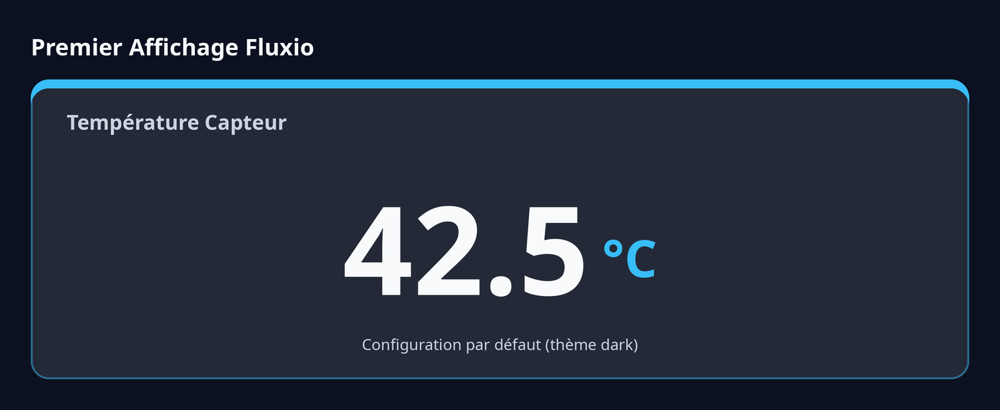
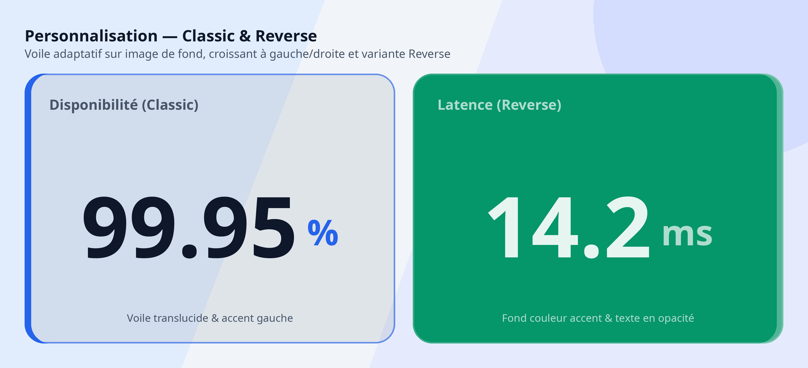
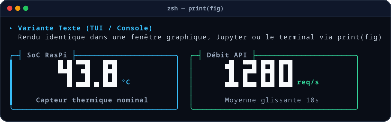
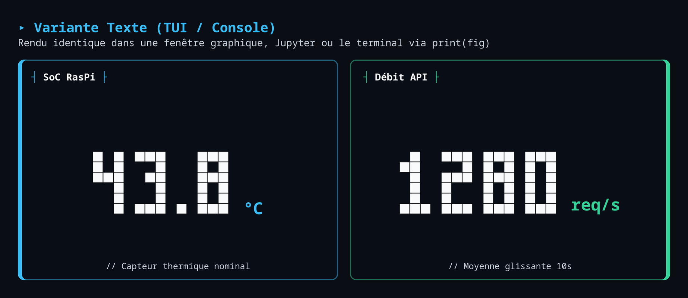
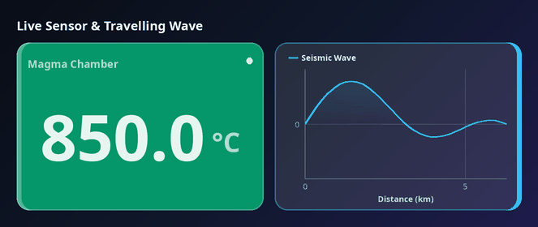

<p align="center">
  
</p>

<h1 align="center">Fluxio</h1>

<p align="center">
  <strong>Moteur de visualisation moderne, temps réel et ultra-léger pour Python, Jupyter, le Terminal et les applications IA.</strong>
</p>

<p align="center">
  
  
  
</p>

---

## 1. Présentation du projet

**Fluxio** est un module de visualisation hybride (**Python + TypeScript `<canvas>`**) conçu pour dépasser les limites esthétiques et ergonomiques de `matplotlib`, sans tomber dans la lourdeur des usines à gaz web.

À l'image du *revontulet* (le renard polaire finnois dont la queue dessine les aurores boréales), Fluxio transforme un code Python concis en visualisations fluides, modernes et intégralement personnalisables — capables de tourner à **60 FPS** aussi bien sur un PC de bureau que sur un **Raspberry Pi**, dans un **notebook Jupyter**, dans un **terminal SSH** ou au cœur d'un **chatbot IA (Web / Flutter)**.

### Pourquoi Fluxio ?

* **Un seul objet `fig` partout** : plus besoin de réécrire son code entre `matplotlib` pour les fenêtres, `plotly` pour le web et `plotext` pour le terminal. La même figure s'ouvre en fenêtre native (`fx.show(fig)`), persiste entre les cellules Jupyter (`fig`), s'imprime en couleurs ANSI dans la console (`print(fig)`) et s'exporte en fichiers autonomes (`fig.save(...)`).
* **Esthétique sur-mesure ("Slide-ready")** : cascade de styles globale (`fig.style(...)`) et par cellule (`fig[x, y].style(...)`), fonds en **dégradés** ou **images**, cartes à **voile translucide adaptatif** (clair sur fond sombre, sombre sur fond lumineux), bordures en **croissant effilé** orientables et transitions de survol progressives sans *popping*.
* **Temps réel natif** : accepte directement une fonction du temps `f(t)` ou un **générateur Python (`yield`)** diffusé en WebSocket local avec contrôles intégrés (Lecture/Pause, Reset, Zoom/Pan, Capture PNG, Plein écran).
* **Poids plume & 100 % hors-ligne** : moteur TypeScript Canvas 2D compilé en **~28 Ko** sans aucun framework ni CDN externe ; exports images et vidéos générés sans navigateur headless lourd.

### Installation (développement)

```bash
# Installer l'environnement Python (uv)
uv sync

# (Optionnel, si vous modifiez le moteur TypeScript dans web/)
corepack pnpm install
corepack pnpm build

# Lancer les suites de tests
uv run pytest
corepack pnpm test
```

---

## 2. Tutoriel : Du plus simple au temps réel

### A. L'exemple le plus minimaliste (2 lignes)

Chaque visualisation (`fx.Plot`, `fx.Number`…) hérite de `fx.Visual` et fonctionne **directement toute seule**, sans même avoir besoin de créer une `Figure` :

```python
import fluxio as fx

fx.Plot([12, 28, 19, 37, 31, 46]).show()   # Fenêtre interactive (x = 0..5 déduit automatiquement !)
# ou : print(fx.Plot([12, 28, 19, 37, 31, 46]))  -> Courbe Braille haute résolution dans le terminal !
```

Et pour un simple indicateur numérique :

```python
import fluxio as fx

fx.Number(
    42.5,
    unit="°C",
    precision=1,
    label="Température Capteur",
    title="Premier Affichage Fluxio",
    description="Configuration par défaut (thème dark)",
).show()
```

<p align="center">
  
</p>

---

### B. Découpage en grille & Variantes `classic` vs `reverse`

Comme les `subplots` de Matplotlib, une `Figure` se découpe en grille `(rows, cols)`.
La méthode `.style(...)` fonctionne **en cascade** : appliquée sur `fig`, elle définit la charte globale ; appliquée sur `fig[row, col]`, elle surcharge uniquement la case choisie.

* **`variant="classic"`** *(défaut)* : carte à voile translucide qui s'adapte automatiquement à la luminance du fond (couleur unie, `fx.Gradient` ou `fx.BackgroundImage`) avec un croissant coloré effilé sur le côté choisi (`accent_side="left" | "right" | "top" | "bottom" | "none"`).
* **`variant="reverse"`** : remplit toute la carte avec la couleur d'`accent` et ajuste l'opacité du texte (`text_opacity`) pour mettre en valeur un indicateur clé.

```python
import fluxio as fx

fig = fx.Figure(
    rows=1,
    cols=2,
    title="Personnalisation — Classic & Reverse",
    subtitle="Voile adaptatif sur image de fond, croissant à gauche/droite et variante Reverse",
    theme="presentation",
    size=(920, 420),
)

# Style global (charte d'entreprise)
fig.style(
    background=fx.BackgroundImage("mon_fond_diapo.png", fit="cover"),
    radius=22,
    accent_width=7.5,
    accent_side="left",
    accent="#2563eb",
    hover_ms=220,  # Transition douce au survol sans popping
)

# Case (0, 0) : hérite du style global (Classic + croissant bleu à gauche)
fig[0, 0].number(
    99.95,
    unit="%",
    precision=2,
    label="Disponibilité (Classic)",
    description="Voile translucide & accent gauche",
)

# Case (0, 1) : surcharge locale en style Reverse avec croissant à droite
fig[0, 1].style(
    variant="reverse",
    accent_side="right",
    accent="#059669",
).number(
    14.2,
    unit="ms",
    precision=1,
    label="Latence (Reverse)",
    description="Fond couleur accent & texte en opacité",
)

fx.show(fig)
```

<p align="center">
  
</p>

> **Astuce PowerPoint** : appelez `fig.style(transparent=True)` avant `fig.save("slide.png")` ou `fig.save("slide.svg")` pour obtenir un fond 100 % alpha transparent prêt à poser sur n'importe quelle diapositive.

---

### C. Variante `text` (TUI / LCD) & `print(fig)` dans le terminal

Vous travaillez à la fois en interface graphique et en SSH dans un terminal ?

1. **Sur n'importe quelle figure**, faire `print(fig)` affiche instantanément la grille dans le terminal en **couleurs ANSI TrueColor** avec cadres Unicode et grands chiffres en blocs façon `btop` :

```python
fig = fx.Figure(
    rows=1,
    cols=2,
    title="Variante Texte (TUI / Console)",
    subtitle="Rendu identique dans une fenêtre graphique, Jupyter ou le terminal via print(fig)",
    size=(920, 400),
)
fig.style(variant="text", accent="#38bdf8", accent_side="left")

fig[0, 0].number(
    43.8,
    unit="°C",
    precision=1,
    label="SoC RasPi",
    description="Capteur thermique nominal",
)
fig[0, 1].style(accent="#34d399", accent_side="right").number(
    1280, unit="req/s", label="Débit API", description="Moyenne glissante 10s"
)

# 1) Affichage direct dans le terminal (remplace plotext !)
#    Appelé dans une boucle (ex: while True: print(fig)), il se met à jour sur place !
print(fig)

# 1bis) Ou laissez Fluxio gérer l'animation temps réel sur place (Espace = Pause, R = Reset, Q = Quitter) :
fig.print()  # (équivalent à fx.print(fig))

# 2) Ouverture de la fenêtre interactive en look TUI / Console
fx.show(fig)
```

Sortie dans le terminal avec `print(fig)` (exportable aussi en vecteur fidèle via `fig.save("console.term.svg")`) :

<p align="center">
  
</p>

Et le rendu graphique correspondant (`fx.show(fig)`, Jupyter ou `fig.save(...)`) avec `variant="text"` :

<p align="center">
  
</p>

---

### D. Courbes & Indicateurs Temps Réel + Exports multi-formats

Toutes les visualisations (`Plot`, `Number`, etc.) acceptent aussi une **fonction du temps `f(t)`** (en secondes) ou directement un **générateur Python (`yield`)**, aussi bien en fenêtre live qu'en export `.gif` / `.mp4` :

<p align="center">
  
</p>

```python
import itertools
import math
import fluxio as fx


def compteur_paquets():
    for i in itertools.count(1):
        yield i * 12


xs = [i * 0.1 for i in range(65)]
fig = fx.Figure(rows=1, cols=2, title="Flux Temps Réel", fps=24)
fig.style(background=fx.Gradient(["#090d16", "#1e1b4b"], angle=135))

fig[0, 0].plot(
    xs,
    lambda t: [math.sin(x - t * 2.5) for x in xs],
    fill=True,
    title="Onde Live",
    color="#38bdf8",
)
fig[0, 1].number(compteur_paquets(), unit="pkt", label="Flux Réseau", color="#a855f7")

# Exports directs (sans navigateur lourd ni Chromium) :
fig.save("capture.png", scale=2.0)  # Image PNG haute définition
fig.save("vecteur.svg")  # SVG vectoriel infini
fig.save("animation.gif", duration=3.0, fps=15)  # GIF animé fluide
fig.save("video.mp4", duration=3.0, fps=24)  # Vidéo MP4 (H.264)
fig.save("autonome.html", duration=3.0, fps=24)  # Fichier HTML interactif 100 % autonome
fig.save("rapport.txt")  # Rendu Unicode + Braille 2×4 sans codes ANSI
```

---

## Documentation complète & Intégration IA

* **Tutoriel pas-à-pas & Galerie visuelle** : lancez `uv run mkdocs serve` (ou consultez [`docs/tutorial.md`](docs/tutorial.md) et [`docs/charts/index.md`](docs/charts/index.md)).
* **Contexte LLM prêt à l'emploi** : [`llms.txt`](llms.txt) (compact), [`llms-full.txt`](llms-full.txt) (complet), [`docs/fluxio.pyi`](docs/fluxio.pyi) (stubs typés) ou directement en Python via `fx.llm_context("compact")`.

## Exemples prêts à lancer

* [`examples/all_examples/`](examples/all_examples/) : **1 notebook Jupyter pré-exécuté par visualisation** ([`number.ipynb`](examples/all_examples/number.ipynb), [`plot.ipynb`](examples/all_examples/plot.ipynb), etc.) montrant tous les cas d'usage (minimal, multi-séries, variantes `classic`/`reverse`/`text`, animations temps réel et `print`).
* [`examples/01_window_demo.py`](examples/01_window_demo.py) : démonstration hybride `print(fig)` + fenêtre interactive (`--variant classic|reverse|text`, `--no-window`).
* [`examples/03_exports_demo.py`](examples/03_exports_demo.py) : génération de tous les formats d'export dans `examples/out/`.
* [`examples/04_plot_demo.py`](examples/04_plot_demo.py) : courbes 2D multi-séries, lissage, aire sous la courbe, terminal Braille `2×4` et temps réel.
