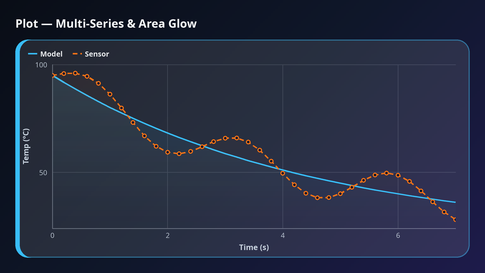
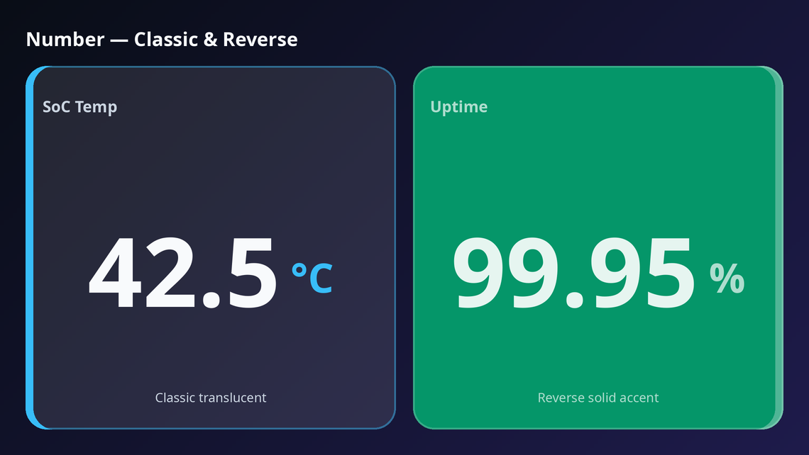

# Visualizations Gallery

Every preview below is **auto-generated directly by Python** (`uv run python -m fluxio.ai_docs`). Click any card to view its full signature, parameters, and copy-pasteable examples.

## 1. Basic 1D / 2D Charts

  <a class="fx-gallery-card fx-cyan" href="plot/">
    
    

      Axis2D
      <h3 class="fx-gallery-title">Plot — fig.plot()</h3>
      
Continuous & dashed multi-series curves, Grafana-style area glow, magnetic hover tooltip, and Braille TUI.

    

  </a>

## 8. Indicators & KPIs

  <a class="fx-gallery-card fx-emerald" href="number/">
    
    

      Indicator
      <h3 class="fx-gallery-title">Number — fig.number()</h3>
      
Single KPI metric card supporting static values, f(t) functions, generators, and classic/reverse/text variants.

    

  </a>

