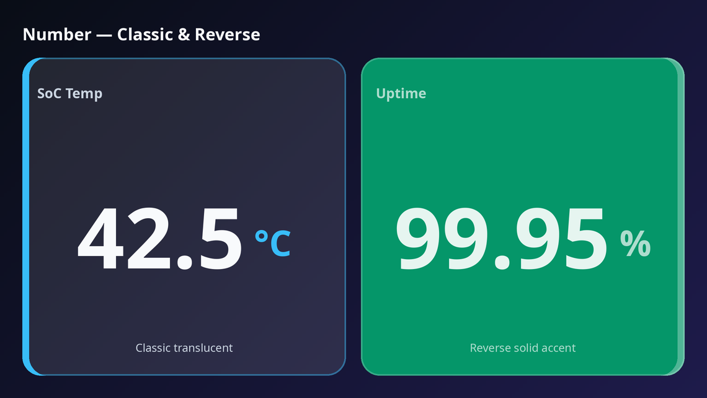
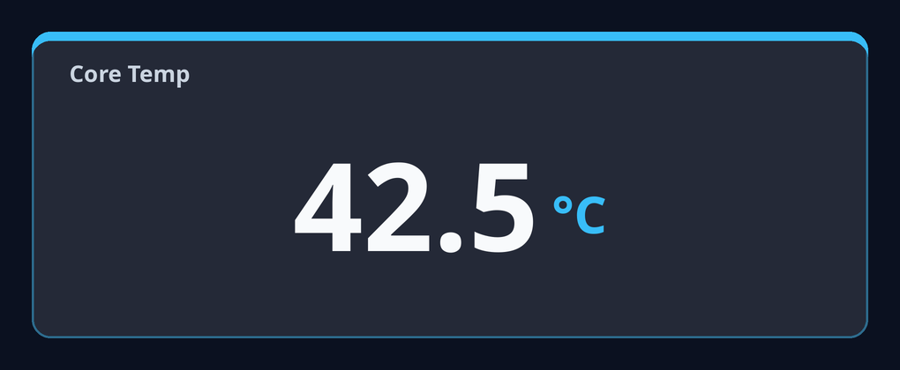
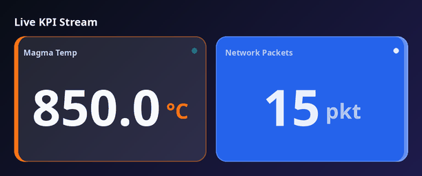
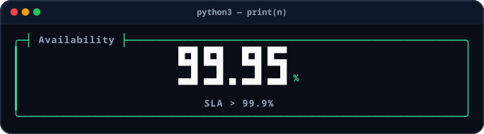

# `Number` / `fig.number()` — Numeric KPI & Live Value Card

{ .fx-chart-preview }

Displays a single numeric metric (static value, continuous function of time `f(t)`, or Python generator `yield`).

Inherits from **`Indicator` -> `Visual`** (3-level hierarchy): works both **standalone** (`fx.Number(...).show()`) and **inside a multi-cell `Figure`** (`fig.number(...)`, `fig[r, c].number(...)`, or `fig[r, c] = fx.Number(...)`).

---

## Signatures

```python
# 1. Standalone or assignable object
num = fx.Number(
    value: int | float | Callable[[float], int | float] | Iterator[int | float],
    *,
    label: str = "",
    unit: str = "",
    prefix: str = "",
    precision: int | None = None,
    color: str | None = None,
    description: str = "",
    title: str = "",
    subtitle: str = "",
    theme: str = "dark",
    size: tuple[int, int] = (780, 340),
)

# 2. Directly on a Figure or SubplotSlot
fig.number(
    value: int | float | Callable[[float], int | float] | Iterator[int | float],
    *,
    label: str = "",
    unit: str = "",
    prefix: str = "",
    precision: int | None = None,
    color: str | None = None,
    description: str = "",
    row: int | None = None,
    col: int | None = None,
    row_span: int = 1,
    col_span: int = 1,
) -> Number
```

## Parameters & Specificities

| Parameter | Type | Default | Description |
| :--- | :--- | :--- | :--- |
| `value` | `int \| float \| Callable \| Iterator` | *required* | Static number, `fn(t_seconds)` callable, or Python generator yielding numbers. |
| `label` | `str` | `""` | Header title displayed at the top-left of the card (`┤ Label ├` in `text` variant). |
| `unit` | `str` | `""` | Unit suffix displayed next to the number (e.g. `"°C"`, `"%"`, `"ms"`). |
| `prefix` | `str` | `""` | Prefix prepended before digits (e.g. `"€"`, `"$"`). |
| `precision` | `int \| None` | `None` | Fixed decimal places (`None` auto-formats integers cleanly and trims trailing zeros up to 3 decimals). |
| `color` | `str \| None` | `None` | Shorthand hex color override for this cell's accent and value. |
| `description` | `str` | `""` | Context subtitle displayed at the bottom of the card (shown automatically when card height ≥ 130 px). |

!!! tip "Auto-Fitting Typography & `reverse` Contrast"
    - **Overflow protection**: If a formatted number + unit is wider than the card, Fluxio automatically scales the font size down proportionally so digits never clip.
    - **`variant="reverse"`**: Fills the card with `accent` and automatically picks `#ffffff` or `#090d16` ink based on WCAG luminance, applying `text_opacity` (default `0.90` on digits, `~0.68` on label/unit) so text blends harmoniously into the card hue.

---

## Examples

=== "1. Minimal"

    ```python
    import fluxio as fx

    fx.Number(42.5, unit="°C", label="Core Temp").show()
    ```

    { .fx-chart-preview }

=== "2. Animated `.gif` (Generator & `f(t)`)"

    ```python
    import itertools
    import math
    import fluxio as fx

    fig = fx.Figure(rows=1, cols=2, title="Live KPI Stream", size=(820, 340), fps=16)
    fig.style(background=fx.Gradient(["#090d16", "#1e1b4b"], angle=135), radius=20)

    # Left: continuous function of time t
    fig[0, 0].style(accent="#f97316", accent_side="left").number(
        lambda t: 850.0 + 110.0 * math.sin(2.0 * math.pi * t / 2.0),
        unit="°C",
        precision=1,
        label="Magma Temp",
    )

    # Right: Python generator (`yield`) in `reverse` style
    fig[0, 1].style(variant="reverse", accent="#2563eb", accent_side="right").number(
        (i * 15 for i in itertools.count(1)),
        unit="pkt",
        precision=0,
        label="Network Packets",
    )

    fig.save("number_anim.gif", duration=2.0, fps=16)
    ```

    { .fx-chart-preview }

=== "3. Terminal Output (`print`)"

    ```python
    import fluxio as fx

    n = fx.Number(99.95, unit="%", precision=2, label="Availability", description="SLA > 99.9%")
    n.style(accent="#34d399", accent_side="left")
    print(n)      # Or `n.print()` for live in-place updates!
    ```

    { .fx-chart-preview }
