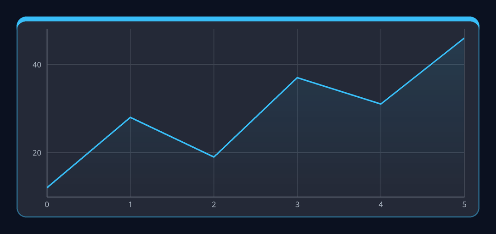
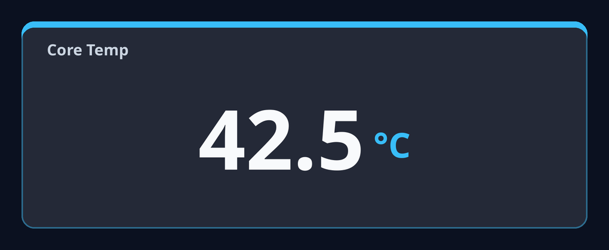
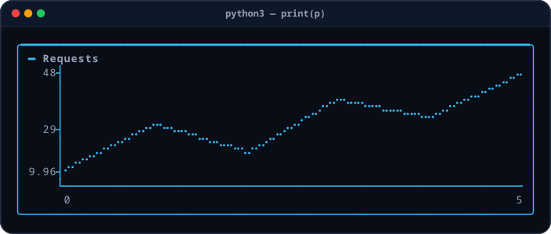
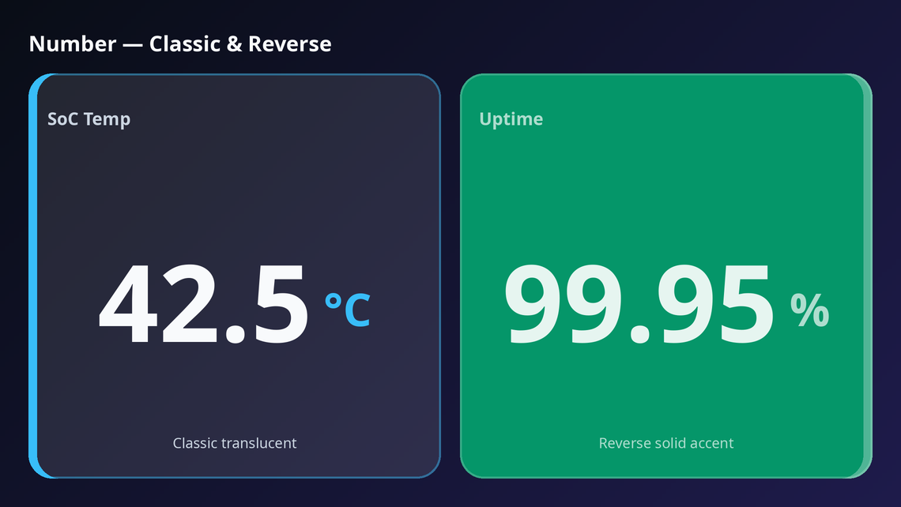
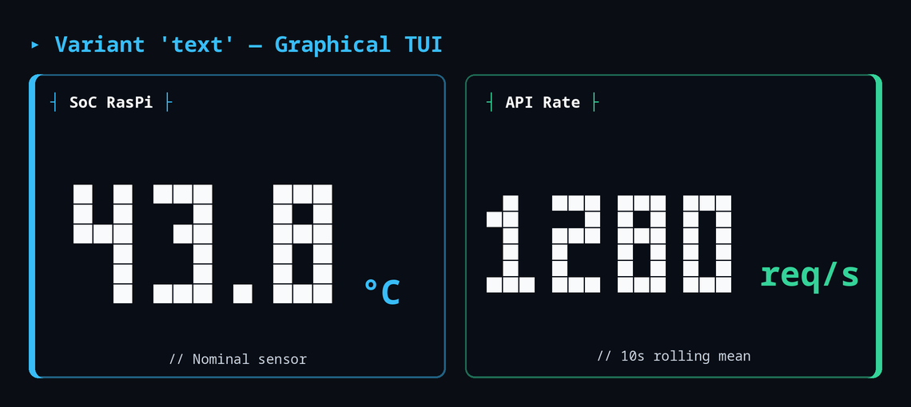
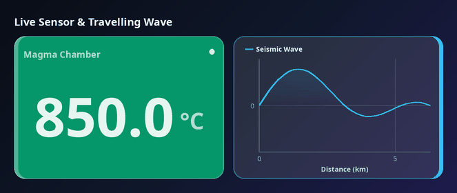

# Step-by-Step Tutorial

This tutorial walks you from the **absolute minimal 2-line Fluxio script** up to multi-panel dashboards, custom corporate themes, real-time animated `.gif` / WebSocket streams, and ANSI terminal rendering.

---

## 1. The Minimal Example (2 Lines)

Every Fluxio visualization inherits from `fx.Visual`, meaning **you do not even need to create a `Figure` container** when displaying a single chart or KPI:

=== "Minimal `Plot`"

    ```python
    import fluxio as fx

    fx.Plot([12, 28, 19, 37, 31, 46]).show()
    ```

    { .fx-chart-preview }

    !!! info "Specificity: Single-Argument `y`"
        When you pass only one sequence (`[12, 28, ...]`), Fluxio automatically generates `x = [0, 1, 2, ...]` and computes human-readable axis ticks (*nice numbers*) with 6% vertical breathing room.

=== "Minimal `Number`"

    ```python
    import fluxio as fx

    fx.Number(42.5, unit="°C", label="Core Temp").show()
    ```

    { .fx-chart-preview }

=== "Terminal (`print`)"

    Replace `.show()` with Python's built-in `print(...)` on **the exact same object** — no extra library (`plotext`) required:

    ```python
    import fluxio as fx

    p = fx.Plot([12, 28, 19, 37, 31, 46], label="Requests")
    print(p)
    ```

    { .fx-chart-preview }

---

## 2. Multi-Cell Grids & Superposition (`fx.Figure`)

When combining multiple visualizations in one window or slide, create a `Figure(rows, cols)` grid.

### Key Specificities of `Figure` Grids

1. **Two Equivalent Placement Syntaxes**:
   - **Builder methods**: `fig[0, 0].number(...)` or `fig.number(..., row=0, col=0)` (auto-places into the next free slot if `row`/`col` are omitted).
   - **Object assignment**: `fig[0, 0] = fx.Number(...)`.
2. **Row & Column Spans**: Pass `col_span=2` or `row_span=2` to make a header KPI or wide chart span multiple cells.
3. **Automatic Curve Superposition on `Plot`**: Calling `fig[r, c].plot(...)` multiple times on **the same `(row, col)` slot** superposes additional curves onto the same axes (with automatic palette cycling and inline legend) rather than overwriting the cell!

```python
import math
import fluxio as fx

fig = fx.Figure(rows=1, cols=2, title="Thermal Experiment", size=(920, 400))

# Left cell (0, 0): KPI card
fig[0, 0].number(250.0, unit="°C", precision=1, label="Target Asymptote")

# Right cell (0, 1): two superposed curves on the same Plot!
xs = [i * 0.25 for i in range(25)]
fig[0, 1].plot(xs, [800 * math.exp(-0.3 * x) + 250 for x in xs], label="Theory", xlabel="t (s)")
fig[0, 1].plot(
    xs,
    [800 * math.exp(-0.3 * x) + 250 + 35 * math.sin(x * 2) for x in xs],
    label="Sensor",
    linestyle="dashed",
    marker="circle",
)

fx.show(fig)
```

---

## 3. Cascading Aesthetics, Variants & Crescents (`.style()`)

Fluxio separates **data** from **aesthetics** through a chainable `.style(...)` method that cascades from the global `Figure` down to individual cells:

```python
fig = fx.Figure(rows=1, cols=2, title="Corporate KPIs", theme="presentation")

# 1. Global defaults for the entire figure
fig.style(
    background=fx.Gradient(["#090d16", "#1e1b4b"], angle=135),
    accent="#38bdf8",
    accent_side="left",   # Tapered crescent on the left (reading order)
    radius=22,
    hover_ms=220,         # Smooth 220ms hover transition (zero popping!)
)

# Cell (0, 0) inherits global left cyan crescent & translucent light veil
fig[0, 0].number(99.95, unit="%", precision=2, label="Availability")

# 2. Local override on cell (0, 1): solid `reverse` fill + right emerald crescent
fig[0, 1].style(
    variant="reverse",
    accent="#059669",
    accent_side="right",
).number(14.2, unit="ms", precision=1, label="Median Latency")
```

{ .fx-chart-preview }

### Specificities Worth Knowing

- **Adaptive Translucent Veil**: In `variant="classic"`, Fluxio computes the WCAG luminance of your background (`#hex`, `fx.Gradient`, or `fx.BackgroundImage`) and automatically picks a subtle **light glass veil (~10% `#ffffff`)** on dark backgrounds or a **dark glass veil (~8% `#0f172a`)** on light backgrounds.
- **PowerPoint Transparency**: Set `fig.style(transparent=True)` before `fig.save("slide.png")` or `fig.save("slide.svg")` to export an alpha-transparent graphic whose card contrast is still calibrated for your target slide color.
- **Graphical TUI Mode (`variant="text"`)**: Switches the Canvas/PNG/SVG renderer to a `btop`-inspired console look (`┤ Label ├` headers, monospace font, and segmented 6-row block-matrix digits):

{ .fx-chart-preview }

---

## 4. Real-Time Dynamics & Animated `.gif` / `.mp4` Exports

Any Fluxio chart accepts **dynamic Python sources** without timers, callbacks, or boilerplate threads:

1. **Time Function `Callable[[float], ...]`**: Receives elapsed time `t` in seconds.
   - On `Plot`, returning a **single float** `f(t) -> y` (or `(x, y)` point) automatically activates **Grafana-style rolling window mode** (`max_points=120`).
   - Returning a **pair of sequences** `f(t) -> (xs, ys)` activates **animated waveform mode** (re-draws the entire curve at instant `t`).
2. **Python Generator (`yield`)**: Yields values step-by-step on each frame tick.

```python
import math
import fluxio as fx

fig = fx.Figure(
    rows=1,
    cols=2,
    title="Live Sensor & Travelling Wave",
    size=(880, 380),
    fps=20,
)
fig.style(background=fx.Gradient(["#090d16", "#0f172a", "#1e1b4b"], angle=135), radius=20)

# Left: dynamic KPI oscillating smoothly
fig[0, 0].style(variant="reverse", accent="#059669", accent_side="left").number(
    lambda t: 850.0 + 95.0 * math.sin(2.0 * math.pi * t / 2.0),
    unit="°C",
    precision=1,
    label="Magma Chamber",
)

# Right: animated travelling wave
xs = [i * 0.18 for i in range(36)]
fig[0, 1].style(accent="#38bdf8", accent_side="right").plot(
    lambda t: (
        xs,
        [math.sin(x - 2.0 * math.pi * t / 2.0) * math.cos(x * 0.3) for x in xs],
    ),
    label="Seismic Wave",
    xlabel="Distance (km)",
    ylim=(-1.15, 1.15),
)

# Export directly to an animated GIF, MP4 video, or offline interactive HTML!
fig.save("live_demo.gif", duration=2.0, fps=16)
fig.save("live_demo.mp4", duration=2.0, fps=24)
fig.save("live_demo.html", duration=2.0, fps=24)
```

{ .fx-chart-preview }

---

## 5. Live Terminal Rendering (`print(fig)` vs `fig.print()`)

Even dynamic animations work directly inside an SSH session, Raspberry Pi console, or Jupyter Notebook `stdout`:

- **Manual Loop Control (`print(fig)`)**: Calling Python's standard `print(fig)` repeatedly tracks how many lines were printed and uses ANSI cursor-up (`\x1b[<N>A`) in TTY terminals (or `clear_output(wait=True)` in Jupyter) to **update in-place without scrolling**:
  ```python
  import time

  for _ in range(40):
      print(fig)        # Updates in-place on frame 2..40!
      time.sleep(0.05)
  ```
- **Automatic Live Loop (`fig.print()` / `fx.print(fig)`)**: Runs the frame loop for you with live non-blocking keyboard controls (**`Space`** = Pause/Play, **`R`** = Reset, **`Q` / `Ctrl+C`** = Quit):
  ```python
  fig.print()                 # Runs interactively until Q or Ctrl+C
  fig.print(duration=5.0)     # Runs for 5 seconds then exits cleanly
  ```
